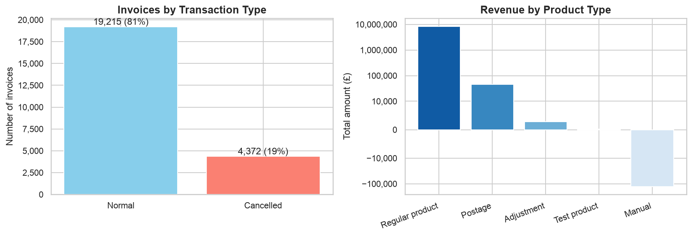
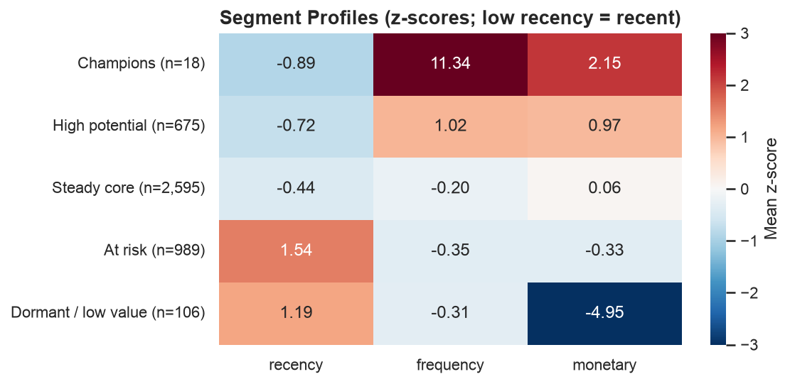
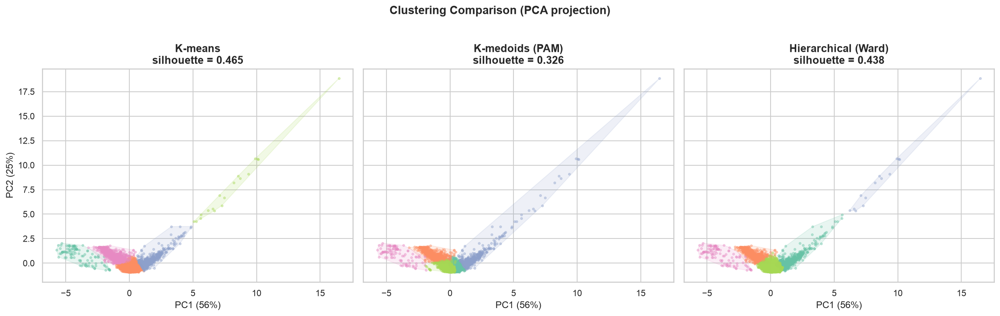
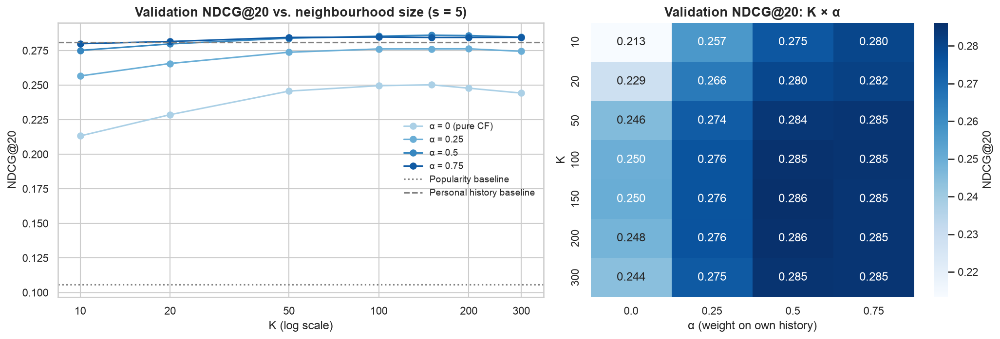
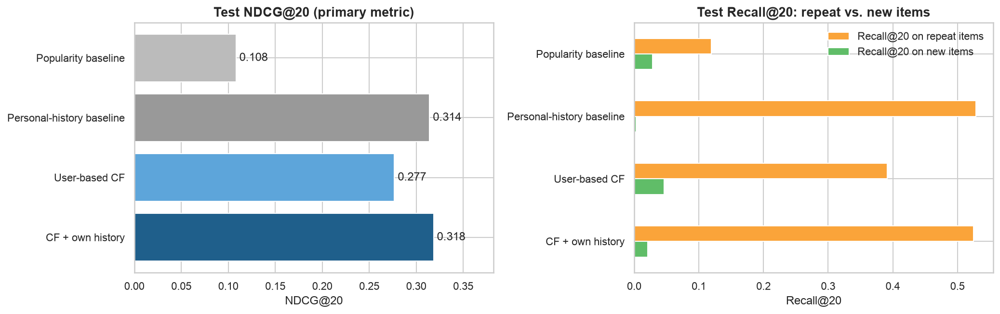

# Online Retail: Customer Segmentation & Recommender System

Customer analytics for a UK online giftware wholesaler: **RFM segmentation** (K-means, validated against K-medoids
and hierarchical clustering) and a **user-based collaborative-filtering recommender** that blends purchase behaviour
with geography.

📓 **[Full analysis notebook](notebooks/online_retail_analysis.ipynb)** · 🧩 [Recommender module](src/recommender.py)

**Skills:** pandas · scikit-learn · clustering (K-means / PAM / Ward) · silhouette analysis · PCA · TF-IDF · cosine similarity · ranking metrics (NDCG) · time-based validation · bootstrap CIs

---

## Data

[Online Retail II](https://archive.ics.uci.edu/dataset/502/online+retail+ii) (UCI ML Repository, CC BY 4.0): every
transaction of a UK-based online retailer from **Dec 2009 to Dec 2010** (525,461 lines). After dropping rows with
no customer ID, 417,534 lines remain, covering 4,383 customers and 4,031 products in 37 countries.

## Key findings

### Exploratory analysis



- **About 19% of invoices are cancellations.** The causes (stock-outs, payment, quality) are worth investigating.
- **Test products appear in production data.** They should be isolated from live sales.
- **The UK accounts for about 84% of revenue.** Foreign markets are barely developed, so localizing for core EU markets is the obvious growth lever.

### RFM segmentation: 5 actionable segments



| Segment | Customers | Profile | Action |
|---|---:|---|---|
| **Champions** | 18 | Very frequent, recent, high spend | Dedicated account managers, custom gift boxes |
| **High potential** | 675 | Above average on all of R, F and M | Spend-milestone rewards to grow them into Champions |
| **Steady core** | 2,595 | Average frequency and spend | Member days and personalized recommendations |
| **At risk** | 989 | Long since last purchase | Win-back campaigns |
| **Dormant / low value** | 106 | Inactive, net refunds | Low-cost channels only |

Monetary uses a **pseudo-log transform** (`sign(x)·ln(1+|x|)`). It keeps net refunds negative and stops a few
large wholesalers from dominating the clusters.

**Robustness check:** K-means has the best silhouette score.

| Algorithm | Silhouette |
|---|---:|
| **K-means** | **0.465** |
| Hierarchical (Ward) | 0.438 |
| K-medoids (PAM) | 0.326 |



### Recommender: does collaborative filtering beat simple baselines?

The task is to recommend **20 products** to each existing customer for their next purchase window.

| Component | Choice |
|---|---|
| Split | **Chronological, three-way**: train (Dec 2009 – Oct 3, 2010) · validation (Oct 3 – Nov 8) · test (Nov 8 – Dec 9). Each later part holds about 15% of purchase lines |
| Tuning | Model fit on **train only**, then grid search over K, similarity sharpness and α by mean **NDCG@20 on validation** |
| Final evaluation | Refit on train + validation, scored **once** on test: **NDCG@20** (primary) and **Recall@20** (secondary), with paired-bootstrap 95% CIs |
| Baselines | **Popularity** (top 20 by distinct buyers) and **personal history** (each customer's own most-bought items) |
| Repeat purchases | **Kept**: 35–44% of what a customer buys next is something they bought before, so these items count as hits for every model |
| Model | User-based CF on 0.8 × TF-IDF(spend) + 0.2 × one-hot(country) profiles. The **hybrid** variant blends in the customer's own history with weight α |



| Model (test set, 1,330 customers) | NDCG@20 | Recall@20 | Recall@20 on *new* items |
|---|---:|---:|---:|
| Popularity baseline | 0.108 | 0.066 | 0.028 |
| Personal-history baseline | 0.314 | 0.237 | 0.003 |
| User-based CF (K = 150) | 0.277 | 0.195 | **0.046** |
| CF + own history (K = 150, α = 0.5) | **0.318** | **0.243** | 0.021 |



- **Personalization pays off.** CF beats the bestseller list by +0.169 NDCG@20 (95% CI [0.158, 0.180]).
- **In wholesale, "buy again" is the baseline to beat.** Pure CF loses to the customer's own purchase history. The tuned hybrid **ties** it (+0.004, CI [−0.004, 0.012]).
- **Discovery comes from pure CF.** It finds products new to the customer about 17× more often than the history baseline does.
- **Recommendation:** use two separate slots, *Buy again* (personal history) and *You may also like* (pure CF, already-purchased items filtered out). A single blended ranking doesn't do both jobs well.

## Repository structure

```
online-retail-analysis/
├── data/                 # online_retail_II.xlsx
├── figures/              # charts exported by the notebook
├── notebooks/
│   └── online_retail_analysis.ipynb   # EDA + RFM segmentation + recommender evaluation
├── src/
│   └── recommender.py    # data split, metrics (NDCG/Recall@k), baselines, user-based CF, tuning
└── requirements.txt
```

## Reproduce

```bash
pip install -r requirements.txt
jupyter lab notebooks/online_retail_analysis.ipynb
# or run the recommender on its own:
python src/recommender.py
```
