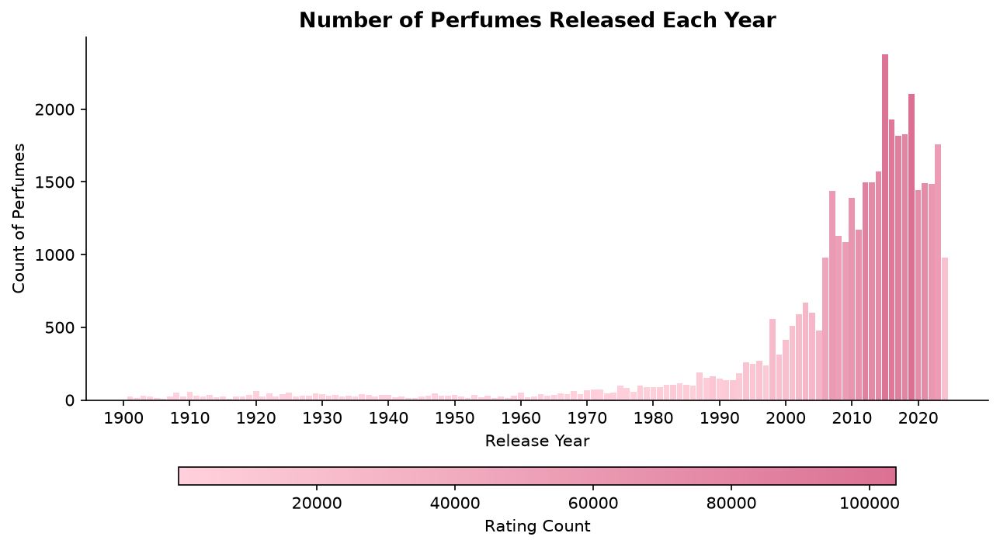
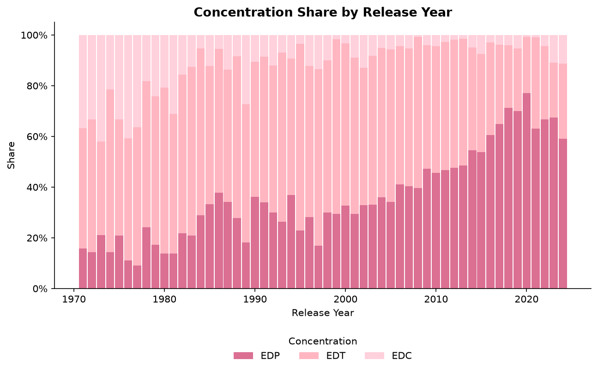
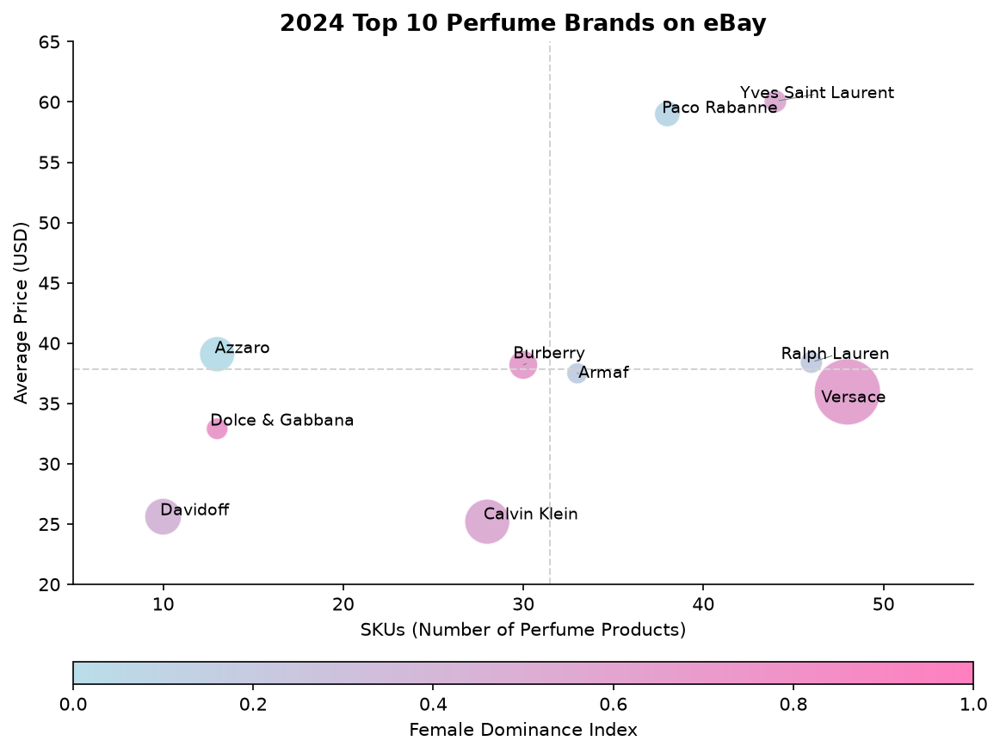
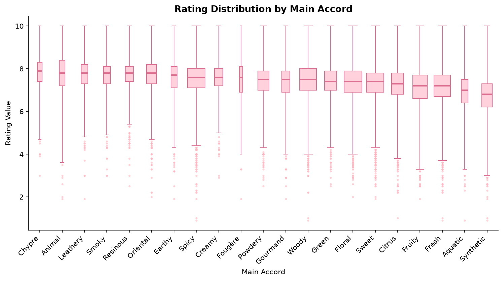
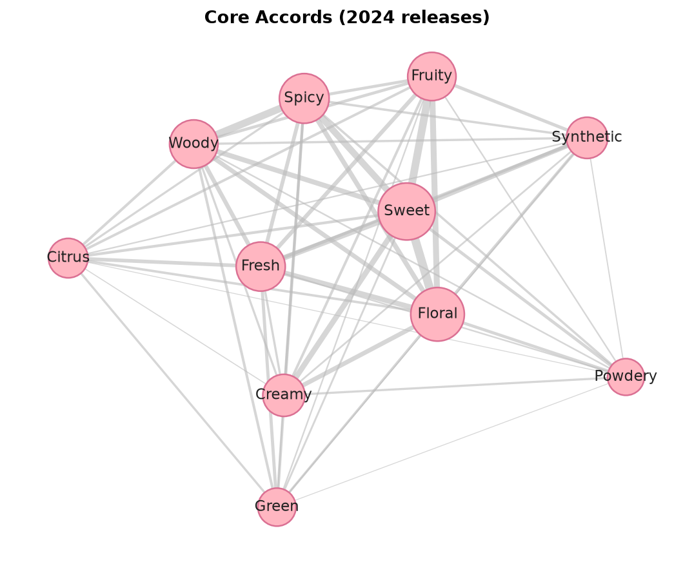
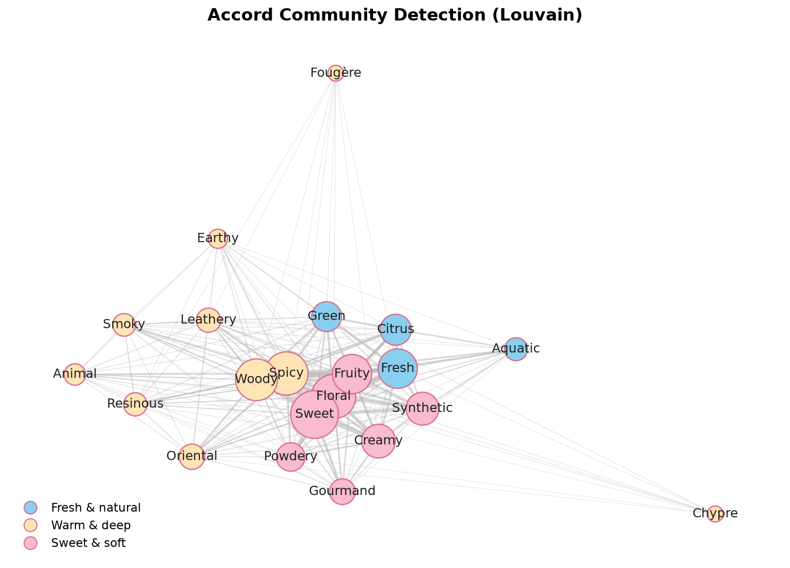

# Fragrance Market Exploration

An exploratory analysis of the fragrance market from three angles: **market trends**, **brand e-commerce
strategy**, and **scent (accord) composition**. It combines community rating data with e-commerce listings and uses
network analysis to find which accords brands blend together.

📓 **[Full analysis notebook](notebooks/perfume_market_analysis.ipynb)** · 📊 [Key-takeaways deck](docs/key_takeaways.pptx)

**Skills:** pandas · data cleaning & text parsing · matplotlib · network analysis (networkx) · Louvain community detection

---

## Questions

1. **Market trends**: How has the number of perfume launches changed, and how has the concentration mix (EDP / EDT / EDC) shifted?
2. **Brand strategy**: How do leading brands position themselves on eBay by assortment breadth, price and gender focus?
3. **Accords**: Which accords do consumers rate highest (demand side), and which accords do brands combine (supply side)?

## Data

| Dataset | Source | Size |
|---|---|---|
| `parfumo.csv` | Perfume records scraped from [Parfumo](https://www.parfumo.com/) (Kaggle, Sep 2024) | 59,315 perfumes |
| `ebay_women.csv`, `ebay_men.csv` | Perfume listings scraped from [eBay](https://www.ebay.com/) (Kaggle, Jun 2024) | 2,000 listings |

## Key findings

### 1. Launches boomed after 2010, and EDP now leads

 

- New releases grew slowly for most of the 20th century, accelerated from the 1980s, **peaked in 2015–2019**, and have declined slightly since (saturation, the pandemic).
- **Eau de Parfum has replaced Eau de Toilette as the dominant concentration**, which fits demand for longer-lasting, more personal scents.

### 2. Brands follow four e-commerce strategies



| | Low price | High price |
|---|---|---|
| **Many SKUs** | Versace, Armaf | YSL, Paco Rabanne, Ralph Lauren |
| **Few SKUs** | Davidoff, Calvin Klein, D&G | Azzaro, Burberry |

Among the top 10 brands, women's fragrances make up about 40% of listings, so the leaders are fairly balanced by
gender. This is consistent with the shift toward **gender-fluid fragrance**.

### 3. Niche accords rate highest; brands blend within three "sensory families"



- Ratings are high overall (median **7.4 / 10**). Niche, warm accords (Chypre, Leathery, Resinous, Oriental) rate highest. Mass-market Fresh, Aquatic and **Synthetic** accords rate lowest, and Aquatic and Synthetic are also the most polarizing.
- On the supply side, an accord co-occurrence network built from 2024 launches has **11 core accords**. Louvain community detection splits all 21 accords into three families: **warm & deep**, **fresh & natural** and **sweet & soft**.

 

## Methods

- **Cleaning:** removed scraped header rows, parsed rating counts from text, and grouped detailed concentration labels into EDP / EDT / EDC with regex rules.
- **Brand metrics:** revenue = price × units sold. The *Female Dominance Index* is the share of a brand's listings that are women's fragrances.
- **Network analysis:** built a binary perfume × accord matrix and computed co-occurrence as `XᵀX`. The core subgraph comes from iteratively pruning nodes with weighted degree < 250. Communities come from Louvain modularity optimization.

## Repository structure

```
perfume-market-analysis/
├── data/                 # raw CSVs (Parfumo, eBay)
├── docs/                 # presentation deck
├── figures/              # charts exported by the notebook
├── notebooks/
│   └── perfume_market_analysis.ipynb
└── requirements.txt
```

## Reproduce

```bash
pip install -r requirements.txt
jupyter lab notebooks/perfume_market_analysis.ipynb
```

## Limitations

- The eBay data is a 2,000-listing sample, so the "top 10 brands" may not be eBay's real best sellers.
- Parfumo is an enthusiast community, so ratings carry self-selection bias (people tend to rate perfumes they chose).
